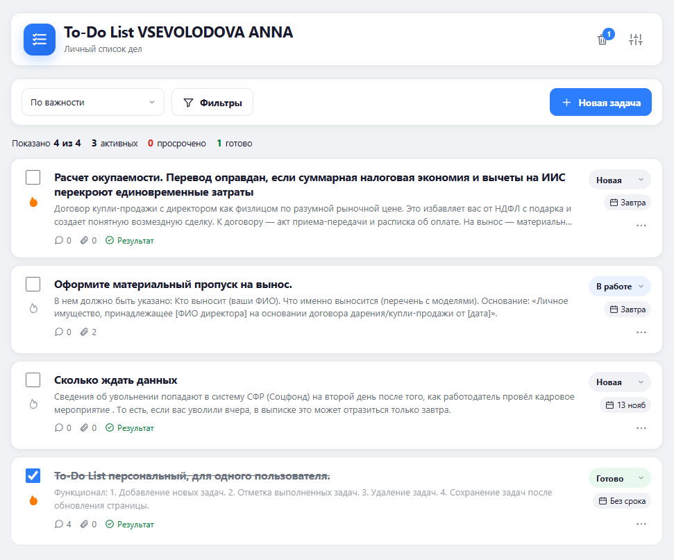
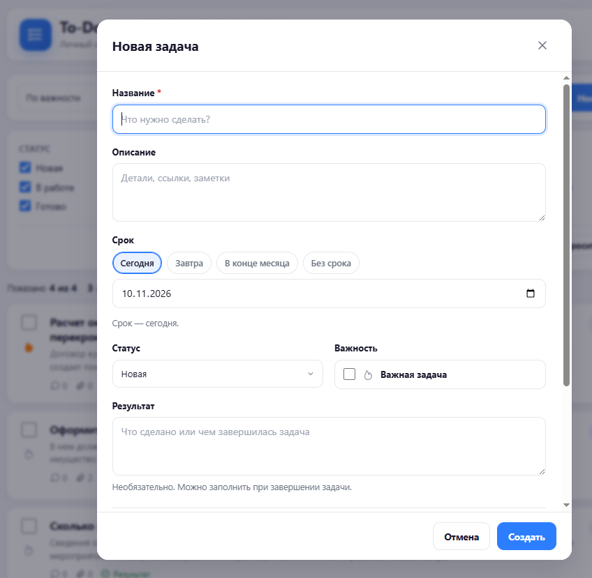
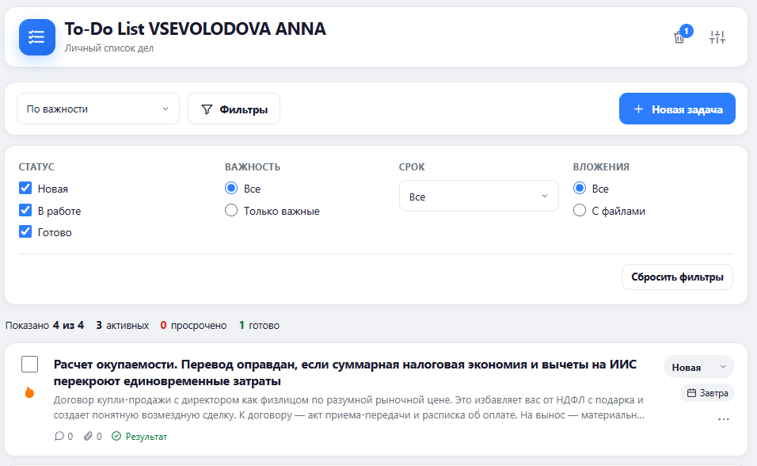
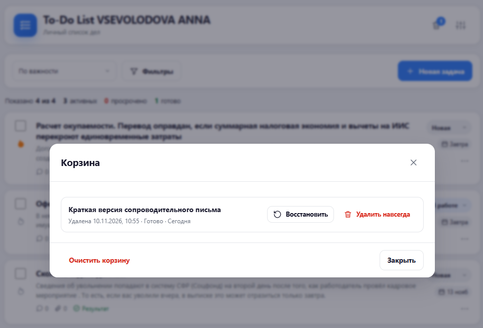

# To-Do List VSEVOLODOVA ANNA

Одностраничное приложение для управления личными задачами: список дел с дедлайнами, статусами, важностью, комментариями и вложениями. Проект работает полностью в браузере, без серверной части и внешних библиотек.

Данные задач и настроек сохраняются в `localStorage`, файлы — в `IndexedDB`. После перезагрузки страницы список, комментарии, вложения, настройки и выбранная сортировка восстанавливаются.

## Скриншоты

### Главный экран



### Создание задачи



### Фильтры



### Корзина



## Возможности

- Создание, редактирование и удаление задач.
- Поля задачи: название, описание, срок, статус, результат, важность, комментарии и вложения.
- Статусы «Новая», «В работе», «Готово» и быстрое завершение через чекбокс.
- Настройка «Запретить перевод в „Готово“ без результата»: при включении завершение задачи требует заполнить результат.
- Сроки: произвольная дата через нативный календарь и быстрые пресеты «Сегодня», «Завтра», «В конце месяца», «Без срока».
- Важность задачи с иконкой огня.
- Комментарии к задаче: добавление, удаление, сохранение сразу после действия.
- Вложения: до 10 файлов, до 10 МБ каждый; предпросмотр изображений, скачивание и удаление.
- Сортировка списка по сроку, дате создания, названию, статусу и важности.
- Фильтры по статусу, важности, сроку и наличию вложений.
- Счётчики: показано задач, активные, просроченные, выполненные.
- Корзина с восстановлением задач, окончательным удалением и очисткой.
- Мягкое удаление, отмена удаления через уведомление в течение 5 секунд и автоочистка задач старше 30 дней.
- Адаптивная вёрстка и управление с клавиатуры.
- Светлая тема; тёмная тема, календарное представление и поиск не предусмотрены по ТЗ.

## Стек

| Слой | Технологии |
|---|---|
| Разметка | HTML5, семантические элементы, нативные `<dialog>`, SVG-спрайт с иконками |
| Стили | CSS3, CSS-переменные, Flexbox, Grid, медиазапросы, `dvh` |
| Логика | Чистый JavaScript (ES2017+), IIFE-модули, `async/await`, `Promise.allSettled` |
| Хранение задач | `localStorage` |
| Хранение файлов | `IndexedDB` (`todo-db`, store `files`) |
| Сборка | Не требуется: статические файлы открываются напрямую через локальный сервер |
| Демо-сервер | Python `http.server` (только для локального запуска) |

Проект не использует фреймворки, сборщики, npm-зависимости и внешние UI-библиотеки.

## Запуск

Из корня проекта:

```bash
python -m http.server 4173 --bind 127.0.0.1
```

Затем открыть:

```text
http://127.0.0.1:4173/
```

Можно использовать и другой статический сервер. Для корректной работы `IndexedDB` и относительных путей рекомендуется запускать приложение через HTTP, а не открывать `index.html` напрямую как `file://`.

## Структура проекта

```text
to_do_digital/
├── index.html              # Разметка страницы и модальных окон
├── css/
│   └── styles.css          # Дизайн-система, компоненты и адаптивность
├── js/
│   ├── utils.js            # Даты, форматирование, экранирование, работа с файлами
│   ├── storage.js          # localStorage, IndexedDB, нормализация данных
│   ├── ui.js               # HTML-шаблоны карточек, комментариев, вложений, корзины
│   └── app.js              # Состояние приложения, события, CRUD, фильтры, сортировка
├── images/                 # Скриншоты для README
│   ├── List.png
│   ├── new_task.png
│   ├── filtr.png
│   └── Delete.png
├── tz-todo-list.md         # Техническое задание
├── дизайн система.png      # Визуальный референс
└── README.md
```

Скрипты подключаются в порядке `utils.js → storage.js → ui.js → app.js`. Модули организованы через пространства имён `TodoUtils`, `TodoStorage`, `TodoUI`; `app.js` связывает их и управляет состоянием интерфейса.

## Дизайн-система

### Принципы

- Только светлая тема.
- Светло-серый фон страницы, белые карточки и панели с мягкой тенью.
- Синий — основной акцент и действия, зелёный — успешное завершение.
- Все интерактивные состояния имеют текстовую подпись или иконку: цвет не является единственным носителем смысла.
- Скругления: карточки и модальные окна — 14 px, кнопки — 10 px, бейджи — pill.
- Шрифт системный: `system-ui`, `Segoe UI`, `Roboto`, `Arial`.
- Отступы и размеры ориентированы на воздушную сетку, контент ограничен по ширине.

### Базовая палитра

| Токен | HEX | Назначение |
|---|---|---|
| `--bg-page` | `#F0F2F5` | Фон страницы |
| `--bg-surface` | `#FFFFFF` | Шапка, панели, карточки, модальные окна |
| `--primary-blue` | `#2D7DFF` | Основные кнопки, ссылки, чекбоксы, фокус, статус «В работе» |
| `--primary-green` | `#00C853` | Акцентные блоки, иконки, статус «Готово» |
| `--text-primary` | `#1A1A2E` | Заголовки, названия задач, основной текст |
| `--text-secondary` | `#6B7280` | Описания, подписи, счётчики, второстепенный текст |
| `--text-on-accent` | `#FFFFFF` | Текст на синих и зелёных акцентных поверхностях |

### Производные цвета состояний

| Токен | HEX | Назначение |
|---|---|---|
| `--primary-blue-hover` | `#1F6BEA` | Hover/pressed синих элементов |
| `--primary-green-hover` | `#00A344` | Hover/pressed зелёных элементов |
| `--green-deep` | `#007A33` | Затемнённый зелёный для мелкого текста |
| `--blue-soft` | `#EAF2FF` | Фон выбранных фильтров и статуса «В работе» |
| `--green-soft` | `#E8F8EE` | Фон статуса «Готово» и успешных уведомлений |
| `--border` | `#E5E7EB` | Границы карточек, полей и разделители |
| `--danger` | `#D92D20` | Просрочки, удаление, ошибки |
| `--danger-soft` | `#FDECEA` | Фон просрочки и ошибок |
| `--fire` | `#FF7A00` | Активная иконка важности |
| `--text-disabled` | `#9CA3AF` | Неактивные элементы и второстепенные иконки |

### Компоненты

- **Шапка** — белая карточка с логотипом, названием, корзиной и настройками.
- **Панель управления** — сортировка, фильтры и основная кнопка «Новая задача».
- **Карточка задачи** — чекбокс, важность, заголовок, описание, метаданные, статус, срок и меню действий.
- **Статусы** — текстовые бейджи с цветовым фоном: «Новая» — нейтральный, «В работе» — синий, «Готово» — зелёный.
- **Срок** — нейтральный бейдж, «Сегодня» — синий фон, просрочка — красный фон.
- **Кнопки** — основная синяя, вторичная с рамкой, опасные действия — красный контур/текст.
- **Модальные окна** — нативные `<dialog>` с заголовком, прокручиваемым телом и фиксированным футером.
- **Уведомления** — тосты с индикатором успеха, ошибки или нейтрального действия и кнопкой закрытия.
- **Акцентные пустые состояния** — синий градиентный блок с белым текстом и кнопкой действия.

### Адаптивность

| Ширина | Поведение |
|---|---|
| ≥ 1024 px | Широкий список с ограничением максимальной ширины контента |
| 600–1023 px | Одноколоночная компоновка |
| < 600 px | Карточки на всю ширину, мобильные отступы, кнопки и элементы управления не меньше 44×44 px, модальные окна на весь экран |

### Доступность

- Семантическая разметка: `header`, `main`, `section`, `article`, `dialog`.
- ARIA-атрибуты для кнопок-иконок, чекбоксов, фильтров, статусов и уведомлений.
- Управление с клавиатуры: `Tab`, `Enter`, `Space`, `Escape`, стрелки в меню задач, `Ctrl/Cmd + Enter` для отправки комментария.
- Фокус-кольцо `2 px #2D7DFF` с отступом 2 px.
- Нативные модальные окна удерживают фокус; после закрытия фокус возвращается на вызвавший элемент или задачу.
- Учитывается `prefers-reduced-motion`.
- Тексты и состояния не передаются только цветом.

## Хранение данных

### localStorage

| Ключ | Содержимое |
|---|---|
| `todo.tasks.v1` | Массив задач |
| `todo.settings.v1` | Настройки приложения |
| `todo.ui.v1` | Выбранная сортировка |
| `todo.tasks.v1.corrupt.<timestamp>` | Резервная копия повреждённого JSON |

### IndexedDB

- База: `todo-db`
- Хранилище: `files`
- Ключ: `id`
- Индекс: `taskId`

В `localStorage` хранятся только метаданные вложений. Сами файлы лежат в `IndexedDB`; при окончательном удалении задачи, очистке корзины или автоочистке связанные файлы удаляются.

## Ограничения

- Нет серверной части, синхронизации между устройствами и авторизации.
- Данные привязаны к браузеру и профилю пользователя.
- При недоступности `localStorage` приложение продолжает работать в памяти и показывает постоянный баннер о невозможности сохранения.
- Вложения требуют поддержки `IndexedDB`; при её отсутствии выводится уведомление.
- Проект реализован по техническому заданию `tz-todo-list.md`; календарное представление, поиск и тёмная тема намеренно отсутствуют.
